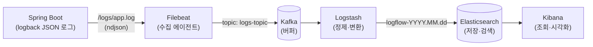

# ELK-LogFlow

> Spring Boot 애플리케이션의 로그를 **구조화(JSON) → 수집(Filebeat) → 버퍼링(Kafka) → 정제(Logstash) → 저장·검색(Elasticsearch) → 시각화(Kibana)** 하는 중앙 로그 파이프라인

서버가 여러 대일 때 장애가 나면 서버마다 접속해서 `grep`으로 로그를 뒤져야 합니다. 이 프로젝트는 그 문제를 해결하려고, 모든 애플리케이션 로그를 한곳으로 모아 **필드 단위로 검색·집계**할 수 있게 만드는 파이프라인을 직접 구성한 것입니다.

<br>

## 아키텍처



| 단계 | 구성 요소 | 역할 |
|---|---|---|
| 생성 | Spring Boot + logback `LogstashEncoder` | 로그 한 건을 JSON 한 줄로 기록 (`level`, `logger_name`, `thread_name`, `stack_trace` …) |
| 수집 | Filebeat 8.10 (`filestream` + `ndjson` 파서) | 로그 파일을 tail 해서 JSON을 필드로 펼친 뒤 Kafka로 전송 |
| 버퍼 | Kafka 7.6 (cp-kafka) | 수집과 적재를 분리. ES 장애·트래픽 폭주 시에도 로그를 보관 |
| 정제 | Logstash 8.10 | Kafka에서 소비해 수집용 메타 필드를 제거하고 일별 인덱스로 적재 |
| 저장·검색 | Elasticsearch 8.10 | 필드 단위 검색, 집계 |
| 시각화 | Kibana 8.10 | Discover 조회. 데이터 뷰는 `kibana-setup` 컨테이너가 자동 생성 |

<br>

## 기술 스택

- **Application**: Java 17, Spring Boot 3.5, Gradle (Kotlin DSL)
- **Logging**: Logback, logstash-logback-encoder
- **Pipeline**: Filebeat, Apache Kafka (+ ZooKeeper), Logstash, Elasticsearch, Kibana (8.10)
- **Infra**: Docker, Docker Compose

<br>

## 설계 포인트

### 1. 애플리케이션에서 처음부터 JSON으로 남긴다
일반 텍스트 로그를 Logstash `grok`으로 파싱하면 정규식 유지보수 부담이 있습니다. 또 여러 줄짜리 stack trace가 이벤트 여러 건으로 쪼개지는 문제도 생깁니다.
애플리케이션이 처음부터 **구조화된 JSON 한 줄**로 남기면 이런 문제가 없습니다.
- 수집 단계는 파싱 없이 필드만 펼치면 됩니다.
- stack trace도 `stack_trace` 필드 하나에 온전히 담깁니다.

### 2. 수집은 경량 에이전트(Filebeat)에 맡긴다
JVM 기반인 Logstash를 앱 서버마다 띄우는 대신, 가벼운 Filebeat를 에이전트로 둡니다.
- Filebeat는 읽은 위치를 registry에 기록합니다. 그래서 **재시작해도 중복·누락 없이** 이어서 수집합니다.
- 롤링된 파일은 `*.gz`로 압축되므로 수집 대상(`*.log`)에 다시 걸리지 않습니다.

### 3. Kafka로 수집과 적재를 분리한다
Filebeat에서 ES로 바로 보내면 다음과 같은 경우 로그가 밀리거나 유실될 수 있습니다.
- ES 장애나 점검
- 배포 직후처럼 로그가 폭증하는 순간

Kafka를 사이에 두면 얻는 것이 세 가지입니다.
- **장애 격리**: ES가 내려가도 로그는 Kafka에 쌓여 있다가, 복구되면 이어서 적재됩니다.
- **부하 완충**: 순간적인 로그 폭증을 Kafka가 흡수하고, Logstash는 자기 속도로 소비합니다.
- **확장성**: 같은 토픽을 다른 컨슈머(알림, 이상 탐지, 데이터 웨어하우스 등)가 함께 구독할 수 있습니다.

### 4. 정제는 Logstash 한곳에서 한다
필드 정리나 변환 규칙을 수집 에이전트마다 흩어 두지 않습니다. Logstash 파이프라인(`logstash/pipeline/logstash.conf`) 한곳에서 관리합니다.

### 5. 인덱스는 일 단위로 나눈다
`logflow-YYYY.MM.dd` 일별 인덱스로 나누면 오래된 로그를 **인덱스 단위로 삭제**할 수 있습니다. 문서를 하나씩 지우는 것보다 훨씬 가볍습니다.

<br>

## 실제 서비스에서의 활용

| 시나리오 | 방법 |
|---|---|
| **장애 원인 추적** | Kibana에서 `level:ERROR`로 필터링 → `stack_trace`, `logger_name`으로 원인 클래스 확인. 서버에 접속할 필요 없음 |
| **배포 후 이상 감지** | 배포 시각 전후의 ERROR 건수를 비교해 롤백 여부 판단 |
| **에러율 모니터링·알림** | 시간대별 ERROR 집계 대시보드, 임계치를 넘으면 Kibana Alert(Slack/메일) 발송 |
| **MSA 요청 추적** | 요청마다 `traceId`를 MDC에 넣으면 JSON 필드로 자동 포함. 여러 서비스의 로그를 하나의 요청 흐름으로 조회 |
| **다중 소비** | 같은 Kafka 토픽을 보안 감사, 사용자 행동 분석 등 다른 시스템이 함께 소비 |

<br>

## 실행 방법

**요구사항**: Docker, Docker Compose (메모리 4GB 이상 권장)

```bash
docker compose up -d --build
```

Kafka와 Elasticsearch가 healthy 상태가 될 때까지 1~2분 정도 걸립니다.

```bash
# 정상 로그 / 에러 로그 발생
curl http://localhost:8080/api/success
curl http://localhost:8080/api/error
```

| 확인 대상 | 방법 |
|---|---|
| Kibana | http://localhost:5601 → Discover → 데이터 뷰 `LogFlow logs` |
| Elasticsearch | `curl "http://localhost:9200/logflow-*/_search?q=level:ERROR&pretty"` |
| Kafka 토픽 | `docker compose exec kafka kafka-console-consumer --bootstrap-server localhost:9092 --topic logs-topic --from-beginning --max-messages 5` |
| Logstash 처리량 | `curl "http://localhost:9600/_node/stats/pipelines?pretty"` |

### 로그 예시
```json
{
  "@timestamp": "2026-10-20T14:24:25.394+09:00",
  "message": "에러 발생! 원인=테스트 오류",
  "logger_name": "pre.assignment.rsupport.controller.AccessController",
  "thread_name": "http-nio-8080-exec-2",
  "level": "ERROR",
  "level_value": 40000,
  "app": "logflow"
}
```

<br>

## 프로젝트 구조

```
├── src/main/java/.../controller/AccessController.java   # 로그 발생용 테스트 API
├── src/main/resources/logback-spring.xml                # JSON 로그 설정 (콘솔 + 롤링 파일)
├── filebeat.yml                                         # 수집 → Kafka 전송
├── logstash/pipeline/logstash.conf                      # Kafka 소비 → 정제 → ES 적재
├── docker-compose.yml                                   # 전체 파이프라인 구성
└── Dockerfile                                           # 멀티스테이지 빌드 (JDK 17 → JRE 17)
```

<br>

## 트러블슈팅

| 문제 | 원인 | 해결 |
|---|---|---|
| 애플리케이션 컨텍스트 로딩 실패 | 내용이 빈 `logback-spring.xml` → Logback XML 파싱 오류(`Premature end of file`) | `LogstashEncoder` 기반 설정 작성 |
| Kafka 컨테이너 기동 실패 | `cp-kafka:latest`(8.x)는 ZooKeeper 모드를 지원하지 않음 | ZooKeeper를 지원하는 `7.6.1`로 버전 고정 |
| Filebeat 기동 실패 | 바인드 마운트한 설정 파일이 권한 검사(strict perms)에 걸림 | `--strict.perms=false` 실행 옵션 적용 |
| 로그가 수집되지 않음 | 앱은 `/app/logs`에 쓰는데 볼륨은 `/logs`에 마운트됨 | `LOGGING_FILE_NAME=/logs/app.log` 환경변수로 경로 통일 |
| 모든 로그에 불필요한 `APP_NAME` 필드 | `springProperty`를 `context` 범위로 선언 → LogstashEncoder가 컨텍스트 속성까지 출력 | `local` 범위로 변경하고 `customFields`로 `app` 필드만 추가 |
| Filebeat deprecated 경고 | 8.x에서 `log` 입력이 deprecated | `filestream` 입력 + `ndjson` 파서로 교체 |

<br>

## 한계와 운영 적용 시 보완점

이 프로젝트는 단일 호스트 데모 구성입니다. 실제 운영에 적용하려면 다음이 필요합니다.

- **보안**: ES `xpack.security` 활성화(인증·TLS), Kafka SASL/TLS, 내부망 외 포트 비공개
- **가용성**: ES 3노드 이상, Kafka 브로커 3대와 replication factor 3, Logstash 다중 인스턴스(같은 consumer group으로 파티션 분산)
- **데이터 수명주기**: 인덱스 템플릿으로 필드 매핑 고정, ILM으로 보존 기간(예: 30일) 후 자동 삭제
- **Kafka 모드**: ZooKeeper 방식 대신 KRaft 모드 사용
- **배포 구조**: Filebeat는 각 앱 서버(또는 k8s DaemonSet)에 두고, Kafka와 ELK는 별도 인프라로 분리
