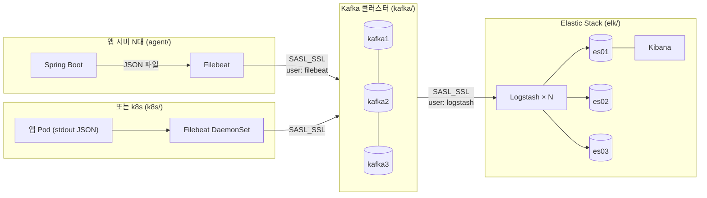

# 운영 배포 구성

루트의 `docker-compose.yml`은 단일 호스트에서 돌리는 **데모 구성**입니다.
이 폴더는 같은 파이프라인을 운영에 올릴 때의 **기준 구성**입니다. 보안, 가용성, 데이터 수명주기, 배포 분리를 반영했습니다.

> 이 구성은 설정 구조를 보여 주기 위한 것이며 실제 기동 검증은 하지 않았습니다. 적용 전에 스테이징 환경에서 확인해야 합니다.

## 구성



```
deploy/prod/
├── .env.example                 # 모든 구성 요소가 공유하는 환경변수 (복사해서 .env 로)
├── scripts/gen-secrets.sh       # Kafka TLS 인증서·키스토어, SASL 계정 파일 생성
├── kafka/
│   ├── docker-compose.yml       # 브로커 3대, KRaft, SASL_SSL, ACL
│   └── init-topics.sh           # logs-topic 생성 + 계정별 ACL
├── elk/
│   ├── docker-compose.yml       # ES 3노드(보안·TLS), Kibana(HTTPS), Logstash × N
│   ├── setup/                   # 인증서 발급, 계정·역할, ILM·템플릿 등록
│   ├── elasticsearch/           # 운영용 인덱스 템플릿 (샤드 3, 복제본 1)
│   └── logstash/pipeline/       # Kafka(SASL_SSL) → ES(HTTPS) 파이프라인
├── agent/
│   ├── docker-compose.yml       # 앱 서버마다: 앱 + Filebeat
│   └── filebeat.yml             # Kafka(SASL_SSL) 로 전송
└── k8s/
    ├── filebeat-daemonset.yaml  # 노드마다 Filebeat (컨테이너 stdout 수집)
    └── app-deployment.yaml      # k8s 프로필로 stdout JSON 출력하는 앱
```

ILM 정책과 공용 등록 스크립트는 데모와 같은 루트 `elasticsearch/` 를 사용합니다.

## 데모 대비 달라진 점

| 항목 | 데모 (`/docker-compose.yml`) | 운영 (`deploy/prod`) |
|---|---|---|
| **ES 보안** | `xpack.security` 꺼짐 | 인증 + HTTP·transport TLS. 계정별 최소 권한 (`logstash_internal`은 `logflow-*` 쓰기만, `logflow_reader`는 조회만) |
| **Kafka 보안** | PLAINTEXT | 모든 리스너 SASL_SSL. ACL 없으면 거부. `filebeat`은 쓰기만, `logstash`는 읽기만 |
| **포트 노출** | 모든 인터페이스 | `BIND_IP`(내부망)에만 바인딩 |
| **ES 가용성** | 단일 노드, 복제본 0 | 3노드, 샤드 3, 복제본 1 → 노드 1대 장애 허용 |
| **Kafka 가용성** | 브로커 1대 | 3대, RF 3, `min.insync.replicas=2`, Filebeat `required_acks: -1` → 브로커 1대 장애에도 유실 없음 |
| **Kafka 모드** | KRaft 단일 노드 | KRaft 3노드 (broker + controller 겸용) |
| **Logstash** | 1대 | N대 (같은 consumer group으로 파티션 6개 분산) + persistent queue |
| **데이터 수명주기** | 템플릿·ILM 동일 | 7일 후 읽기 전용·병합, 30일 후 삭제 |
| **배포 분리** | 한 호스트에 전부 | 앱 서버(agent) / Kafka / ELK 를 별도 서버군으로 분리, k8s는 DaemonSet |

## 기동 순서

```bash
# 0. 환경변수 준비
cp deploy/prod/.env.example deploy/prod/.env    # 값 채우기

# 1. Kafka 인증서·계정 파일 생성 (openssl, keytool 필요)
deploy/prod/scripts/gen-secrets.sh

# 2. Kafka 클러스터 (Kafka 서버군)
docker compose --env-file deploy/prod/.env -f deploy/prod/kafka/docker-compose.yml up -d

# 3. Elastic Stack (ELK 서버군)
docker compose --env-file deploy/prod/.env -f deploy/prod/elk/docker-compose.yml up -d

# 4. 앱 서버마다
docker compose --env-file deploy/prod/.env -f deploy/prod/agent/docker-compose.yml up -d
```

### 비밀값 배포 범위
`gen-secrets.sh`의 결과물(`deploy/prod/secrets/kafka`)은 서버 역할별로 필요한 것만 배포합니다.

| 서버 | 필요한 파일 |
|---|---|
| Kafka 브로커 | `kafka*.keystore.p12`, `truststore.p12`, `*_creds`, `kafka_server_jaas.conf`, `client-admin.properties` |
| Logstash | `truststore.p12` |
| 앱 서버 (Filebeat) | `ca.crt` |
| 어디에도 배포 안 함 | `ca.key` (인증서 재발급용, 별도 보관) |

## 남은 고려 사항

- **비밀값 관리**: 지금은 `.env`와 파일로 다룹니다. 실제로는 Vault, AWS Secrets Manager, k8s Secret 같은 저장소로 옮기고 주기적으로 교체해야 합니다.
- **Kafka 인증 방식**: SASL/PLAIN은 계정을 JAAS 파일에 정적으로 둡니다. 계정을 자주 바꾸려면 SCRAM-SHA-512로 바꾸는 것을 고려합니다.
- **ES 노드 역할 분리**: 규모가 커지면 master 전용 3대와 data(hot/warm) 노드를 나누고, ILM warm 단계에서 노드를 이동시킵니다.
- **스냅샷**: 30일 넘게 보관해야 하는 감사 로그는 삭제 전에 S3 같은 저장소로 스냅샷을 떠 둡니다(SLM).
- **모니터링**: Kafka consumer lag, Logstash 처리량, ES 클러스터 상태를 Metricbeat나 Prometheus로 수집하고 알림을 겁니다.
